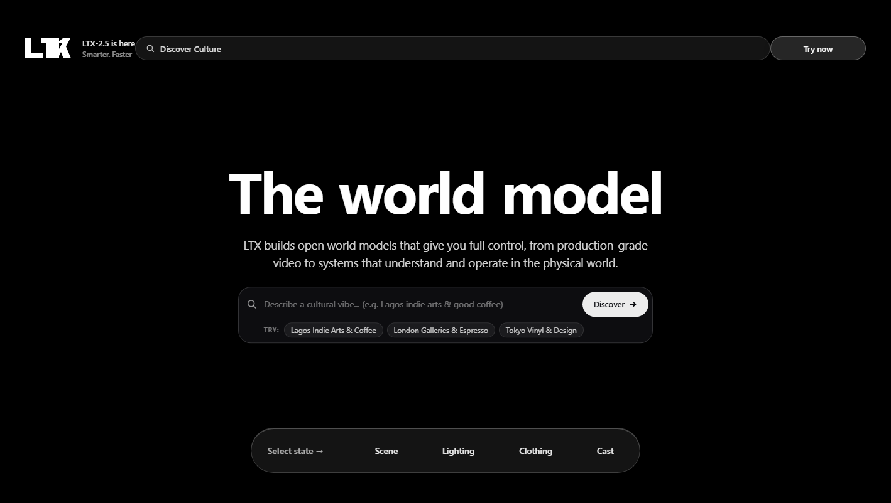
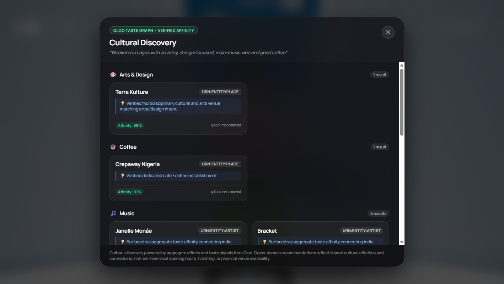
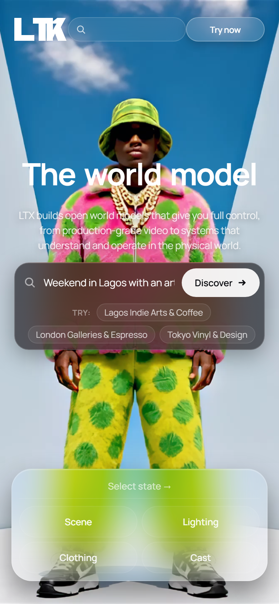
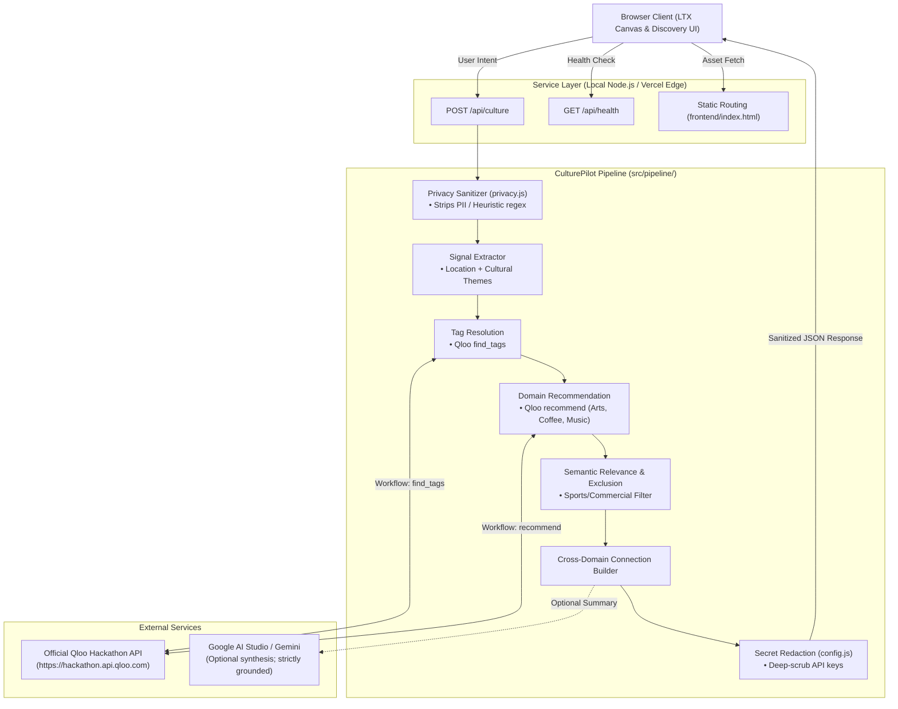

# CulturePilot

> **Autonomous Cross-Domain Cultural Intelligence Powered by Qloo's Taste Graph**

[](#)
[](https://hackathon.api.qloo.com)
[](https://culturepilot-one.vercel.app)
[](https://nodejs.org/)

**CulturePilot** translates natural-language cultural discovery intents into structured, cross-domain cultural recommendations backed by authentic Qloo entity identifiers and mathematical affinity scores.

When users plan a cultural weekend or seek inspiration, their interests inevitably span overlapping creative disciplines—contemporary art, specialty coffee, and independent music. Traditional search engines treat these as disjointed commercial keywords, while generic LLMs hallucinate fictional venues, obsolete events, and fake opening hours.

CulturePilot bridges this gap by grounding natural-language cultural intent in **Qloo’s cultural intelligence engine**, surfacing verified venues and artists with traceable provenance, transparent domain separation, and clear affinity explanations.

---

## Verified Project Links

- **Production Live Demo:** [https://culturepilot-one.vercel.app](https://culturepilot-one.vercel.app)
- **GitHub Repository:** [https://github.com/JimmyOgb/CulturePilot](https://github.com/JimmyOgb/CulturePilot)
- **Health Check:** [https://culturepilot-one.vercel.app/api/health](https://culturepilot-one.vercel.app/api/health)
- **Local Endpoint:** `http://localhost:3001`

---

## Visual Experience & Walkthrough

CulturePilot couples a cinematic, LTX-inspired world-model interface with a real-time cultural discovery drawer.

### 1. Desktop Experience & Cinematic World Model
The landing interface presents an immersive, eight-stream persistent video stage with interactive branch controllers (**Scene**, **Lighting**, **Clothing**, and **Cast**), paired with a docked natural-language cultural discovery bar.



### 2. Live Qloo Cultural Discovery & Grounded Intelligence
Submitting a natural-language intent opens a glass results panel showcasing domain-separated recommendations, aggregate affinity scores, cross-domain taste correlations, and transparent diagnostics.



### 3. Mobile Responsive Viewport
CulturePilot is engineered for modern mobile screens (390px iPhone profile), ensuring full responsive touch interaction and accessible drawer controls.



---

## The Problem & The Solution

### The Cultural Discovery Dilemma
Consider a user who asks:
> *"I want a weekend in Lagos with an artsy, design-focused, indie-music vibe and good coffee."*

Standard discovery tools fail this intent in three distinct ways:
1. **Domain Fragmentation:** Maps tools return isolated point-of-interest pins without understanding the cultural harmony connecting an indie music lover with an artisan roastery.
2. **Generative Hallucination:** LLMs invent non-existent cafes, fabricate ticket availability, and substitute closed or irrelevant commercial chains.
3. **Irrelevant Keyword Matching:** Naive keyword algorithms often conflate "arts" with unrelated sports centers or commercial complexes located within the same municipal boundary.

### The CulturePilot Solution
CulturePilot handles the request through an orchestrated, responsible pipeline:
1. **Sanitizes and Strips PII:** Removes personal phone numbers, emails, and street addresses before any external query.
2. **Resolves Cultural Taxonomy (`find_tags`):** Queries Qloo's official Hackathon endpoint to map concepts like "indie rock", "contemporary art", and "specialty coffee" to verified taste taxonomy IDs.
3. **Executes Categorized Discovery (`recommend`):** Resolves verified entities in parallel across three distinct creative domains:
   - **Arts & Design:** e.g., *Terra Kulture* (Qloo UUID: `B15A3789-6289-4F03-86C4-03561CC9AAF8`, Affinity: `0.888`)
   - **Coffee & Cafes:** e.g., *Crepaway Nigeria* (Qloo UUID: `B1BD1C45-B073-4C0E-9725-7438E312EB53`, Affinity: `0.907`)
   - **Independent Music:** e.g., *Janelle Monáe* (`5032D31E-1B79-4A40-901D-DCDDFA0F4493`), *Bracket* (`B6677EDD-2AEA-48A9-ACAF-02D997EA2742`)
4. **Calculates Cross-Domain Taste Connections:** Identifies mathematical affinity vectors bridging physical venues with musical atmospheres (e.g., *Terra Kulture* ↔ *Janelle Monáe*).
5. **Applies Semantic Exclusion Filters:** Detects and transparently routes athletic, educational, and religious complexes into an audit disclosure accordion.
6. **Honest Empty Reporting:** If Qloo lacks verified entities for a specific city or category, CulturePilot honestly displays an empty badge rather than fabricating artificial substitutes.

---

## What Makes CulturePilot Different

| Feature | Generic Search & LLMs | CulturePilot + Qloo |
| :--- | :--- | :--- |
| **Entity Grounding** | Synthetic or unverified text | 100% verified Qloo canonical UUIDs and provenance trace |
| **Domain Separation** | Mixed, unorganized lists | Strict separation of Arts & Design, Coffee, and Music |
| **Cross-Domain Taste** | None | Real aggregate taste affinity correlations between venues and artists |
| **Transparency & Diagnostics** | Hides exclusions | Discloses excluded athletic/commercial facilities with clear reasoning |
| **Empty State Handling** | Fabricates plausible venues | Honestly reports zero cataloged matches |
| **Privacy & PII Protection** | Often forwards raw prompts | Server-side regex scrubbing of emails, phones, and addresses |
| **Secret Management** | Client-side risk | Server-only credential isolation; deep string/object redaction |
| **Visual Immersion** | Flat forms | Cinematic LTX world-model stage with 4 scene branches |

---

## System Architecture

CulturePilot operates on a dual-deployment architecture: a standalone Node.js HTTP server for local development and optimized Vercel Serverless Functions for production.



### Component Breakdown
- **Frontend ([frontend/index.html](file:///frontend/index.html)):** Lightweight, zero-dependency client with an eight-stream video controller, responsive glass drawer, full keyboard accessibility, and XSS sanitization (`escapeHtml`).
- **HTTP / Serverless Boundary ([src/server.js](file:///src/server.js), [api/culture.js](file:///api/culture.js)):** Enforces CORS preflights, 1 MB payload limits, request parsing, and error encapsulation.
- **Intent Pipeline ([src/pipeline/intent-pipeline.js](file:///src/pipeline/intent-pipeline.js)):** Orchestrates multi-step entity resolution and cross-domain correlation.
- **Qloo Adapter ([src/qloo/qloo-adapter.js](file:///src/qloo/qloo-adapter.js)):** Integrates with `@qloo/qloo-harness` (`0.1.26`) to execute `find_tags`, `describe`, `recommend`, and `rank` against `https://hackathon.api.qloo.com`.
- **In-Memory Cache ([src/cache.js](file:///src/cache.js)):** Caches taxonomy tags and entity queries with configurable TTL to protect API quotas.
- **Privacy Engine ([src/pipeline/privacy.js](file:///src/pipeline/privacy.js)):** Scrubbing engine for personal identifiers.
- **Gemini Client ([src/gemini/gemini-client.js](file:///src/gemini/gemini-client.js)):** Optional AI Studio integration that degrades safely to deterministic Qloo mode when unconfigured.

---

## Genuine Qloo Integration

CulturePilot communicates exclusively with the official Qloo Hackathon endpoint:
- **Base URL:** `https://hackathon.api.qloo.com`
- **Authentication:** Server-side bearer key (`QLOO_API_KEY`) isolated in environment variables.

### Implemented Qloo Workflows
1. **`find_tags`:** Discovers cultural taxonomy tags and affinities matching user keywords.
2. **`describe`:** Fetches ground-truth entity profiles, addresses, and cultural descriptors.
3. **`recommend`:** Surfaces cross-domain recommendations across places and artists using verified taxonomy tags and geographic bounding.
4. **`rank`:** Normalizes taste affinity scores (0.0 to 1.0) and popularity rankings.

### Entity Provenance & Authenticity Guarantee
Every result card returned in the UI includes an explicit provenance payload:
```json
{
  "entity_id": "B15A3789-6289-4F03-86C4-03561CC9AAF8",
  "name": "Terra Kulture",
  "category": "arts_and_design",
  "type": "urn:entity:place",
  "affinity": 0.8876798966847235,
  "popularity": 0.9934159231024393,
  "properties": {
    "address": "Plot 1376 Tiamiyu Savage St Victoria Island Lagos 106104 Lagos, Nigeria"
  },
  "source": {
    "workflow": "recommend",
    "qloo_entity_id": "B15A3789-6289-4F03-86C4-03561CC9AAF8"
  }
}
```
CulturePilot never fabricates venues, events, opening hours, or ticketing data.

---

## Optional Gemini Integration

CulturePilot integrates optionally with Google AI Studio using the official `@google/genai` SDK:
- **Fallback Guarantee:** If `GEMINI_API_KEY` is not configured, CulturePilot operates purely in deterministic Qloo mode. The application never fails or crashes due to a missing AI key.
- **Strict Grounding:** The curator prompt explicitly forbids the model from introducing entities not already returned and verified by Qloo.
- **Safe Rendering:** Any model-generated narrative is treated as untrusted text and sanitized through `escapeHtml()` before DOM insertion.

---

## Security, Privacy & Responsible Use

1. **Zero Secret Leakage:** Server-side `redactSecrets()` recursively traverses all response objects and error traces, completely purging `QLOO_API_KEY` and hex patterns. Client JavaScript bundles contain zero credentials.
2. **Request Bounding:** Server parses incoming request streams with a strict 1 MB (`1048576` bytes) limit, immediately destroying runaway sockets.
3. **PII Sanitization:** The privacy engine redacts emails, telephone numbers, IP addresses, street addresses, and self-identifying introductions.
4. **XSS Hardening:** Dynamic entity names, addresses, reasons, warnings, and curator texts pass through HTML entity encoders (`&`, `<`, `>`, `"`, `'`).
5. **Ethical Framing:** The UI footer prominently notes:
   > *"Cultural discovery powered by aggregate affinity and taste signals from Qloo. Cross-domain recommendations reflect shared cultural affinities and correlations, not real-time local opening hours, ticketing, or physical venue availability."*

---

## Technology Stack

- **Runtime:** Node.js `>= 22.19.0` (ES Modules)
- **Qloo Integration:** `@qloo/qloo-harness@0.1.26` (pinned registry package)
- **AI Enhancement:** `@google/genai@^2.28.0` (optional)
- **Configuration:** `dotenv@^18.0.6`
- **Hosting / Deployment:** Vercel Serverless Functions + Static Asset Hosting
- **Testing Engine:** Built-in Node.js Test Runner (`node:test`, `node:assert/strict`)

---

## Installation & Local Setup

### Prerequisites
- Node.js `>= 22.19.0` (Native `fetch`, `WebSocket`, and `node:test` support)
- npm `>= 10.0.0`
- A valid Qloo Hackathon API Key

### 1. Clone & Install
```bash
# Clone the repository
git clone https://github.com/JimmyOgb/CulturePilot.git
cd CulturePilot

# Install dependencies from registry
npm install
```

### 2. Configure Environment
Copy the example configuration and add your Qloo credentials:
```bash
cp .env.example .env
```
Edit `.env`:
```ini
QLOO_API_KEY=your_qloo_hackathon_api_key_here
QLOO_BASE_URL=https://hackathon.api.qloo.com
QLOO_TRUSTED_BASE_URL=https://hackathon.api.qloo.com
PORT=3001
```

### 3. Run Verification & Test Suites
```bash
# Run the complete automated test suite (44 tests, sequential execution)
npm test

# Run the live end-to-end verification script against Qloo
node verify.js
```

### 4. Start the Application
```bash
npm start
```
Open your browser to:
```
http://localhost:3001/
```

---

## Testing & Verification Evidence

All claims in CulturePilot are backed by direct automated execution:

### 1. Automated Test Suite (`npm test`)
- **Command:** `node --test --test-concurrency=1 tests/**/*.test.js`
- **Status:** **44 / 44 tests passing (100%)**
- **Test Coverage:**
  - `QlooAdapter` input validation, tag discovery, describe profiling, ranking, and recommendations (11 tests)
  - API health, CORS preflight, and cultural processing endpoints (4 tests)
  - Vercel Serverless entrypoints `api/culture.js` and `api/health.js` (4 tests)
  - Configuration validation and deep secret redaction (7 tests)
  - Quality audit regressions (Lagos prompt, London coffee, Indie music, unknown locations) (4 tests)
  - Timeout, rate limit, malformed payloads, and empty response handling (6 tests)
  - UI DOM semantic integration, keyboard navigation, and client security (4 tests)
  - Optional Gemini safe degradation and null fallback (2 tests)
  - Provenance tracing (2 tests)

### 2. Live End-to-End Qloo Verification (`node verify.js`)
- **Command:** `node verify.js`
- **Status:** **4 / 4 verification checks passed (Exit code 0)**
  - API key leaked in response? **PASS (SECURE)**
  - All results backed by real Qloo provenance? **PASS**
  - Any fabricated placeholder entities found? **PASS (GENUINE)**
  - CulturePilot status valid? **PASS**

### 3. Browser CDP Verification (`node tests/browser-verification.js`)
- **Engine:** Google Chrome Headless via Chrome DevTools Protocol
- **Status:** Verified DOM structure, 8 persistent video streams, all 4 LTX branch roundtrips, mobile 390px responsive viewport, reduced-motion preferences, and empty/needs_input/error drawer states.

---

## Limitations & Roadmap

### Current Limitations
1. **Catalog Density:** Qloo’s catalog density varies by geographical market. In high-density cities (e.g., London, Lagos), discovery yields rich multi-domain results. In secondary markets, categories may return an honest empty state.
2. **Static Taste vs. Real-Time Availability:** Recommendations represent aggregate taste correlation. They do not indicate whether a cafe is open right now or whether a concert has available tickets.
3. **Heuristic PII Detection:** Regex-based sanitization provides a strong baseline for standard emails, numbers, and addresses, but cannot guarantee detection of obscure personal information.

### Planned Roadmap
- [ ] Multi-destination comparative taste itineraries (e.g., "Bridge Lagos arts vibe to London").
- [ ] Integration with real-time mapping for walking route optimization.
- [ ] Audio preview integration for surfaced indie artists via open music databases.
- [ ] Localized offline mode with pre-cached cultural taste profiles for international travelers.

---

## Hackathon Submission Summary

- **Problem:** Cultural exploration across multiple creative domains (art, coffee, music) is fragmented, ungrounded, and prone to generative hallucination.
- **Solution:** An autonomous cultural discovery engine that parses natural language and queries Qloo’s Taste Graph to deliver category-separated recommendations with mathematical affinity scores and cross-domain connections.
- **Role of Qloo:** Serves as the single source of truth for taste taxonomy (`find_tags`), entity profiling (`describe`), and domain recommendations (`recommend`).
- **User Benefit:** Travelers and cultural enthusiasts discover authentic cultural scenes in seconds with complete confidence in venue authenticity.
- **Key Differentiator:** Cinematic LTX-inspired world-model UX combined with honest empty-state handling, zero fake data, and strict privacy boundaries.

---

## License & Credits

- **License:** ISC License
- **Qloo Hackathon API:** Powered by the [Qloo Taste Graph](https://qloo.com).
- **World Model Assets:** Cinematic interface media inspired by LTX world model interactive design.
- **Google AI:** Optional structured synthesis powered by Google AI Studio.
